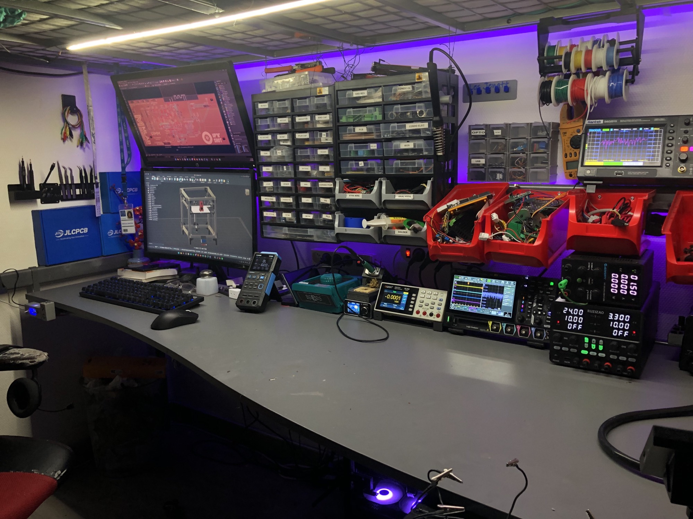
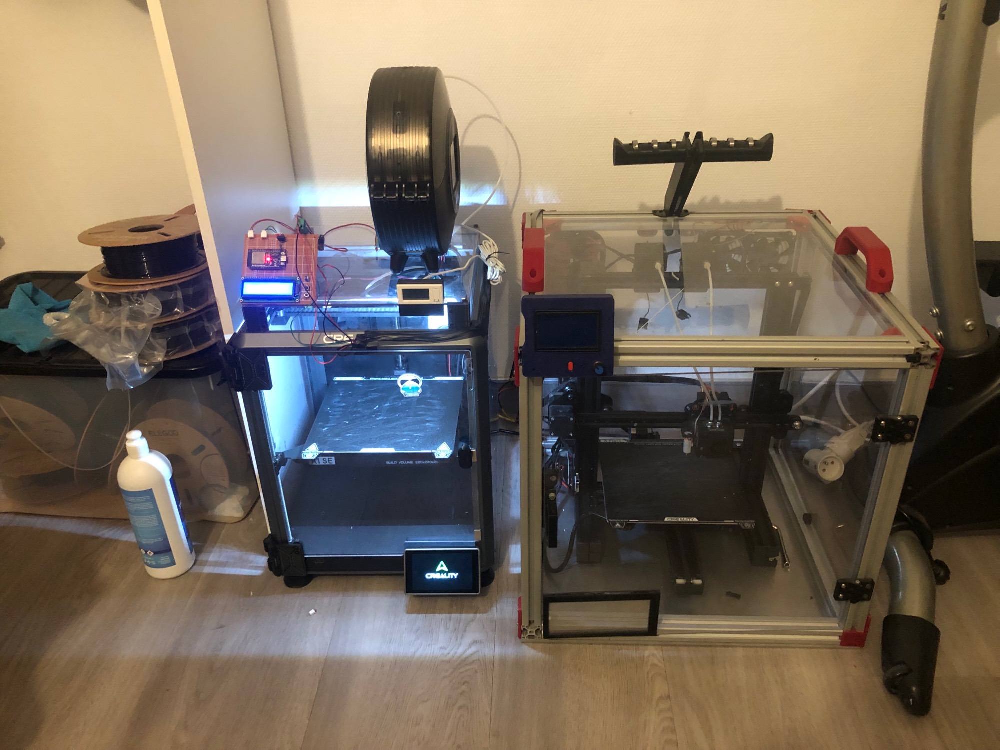
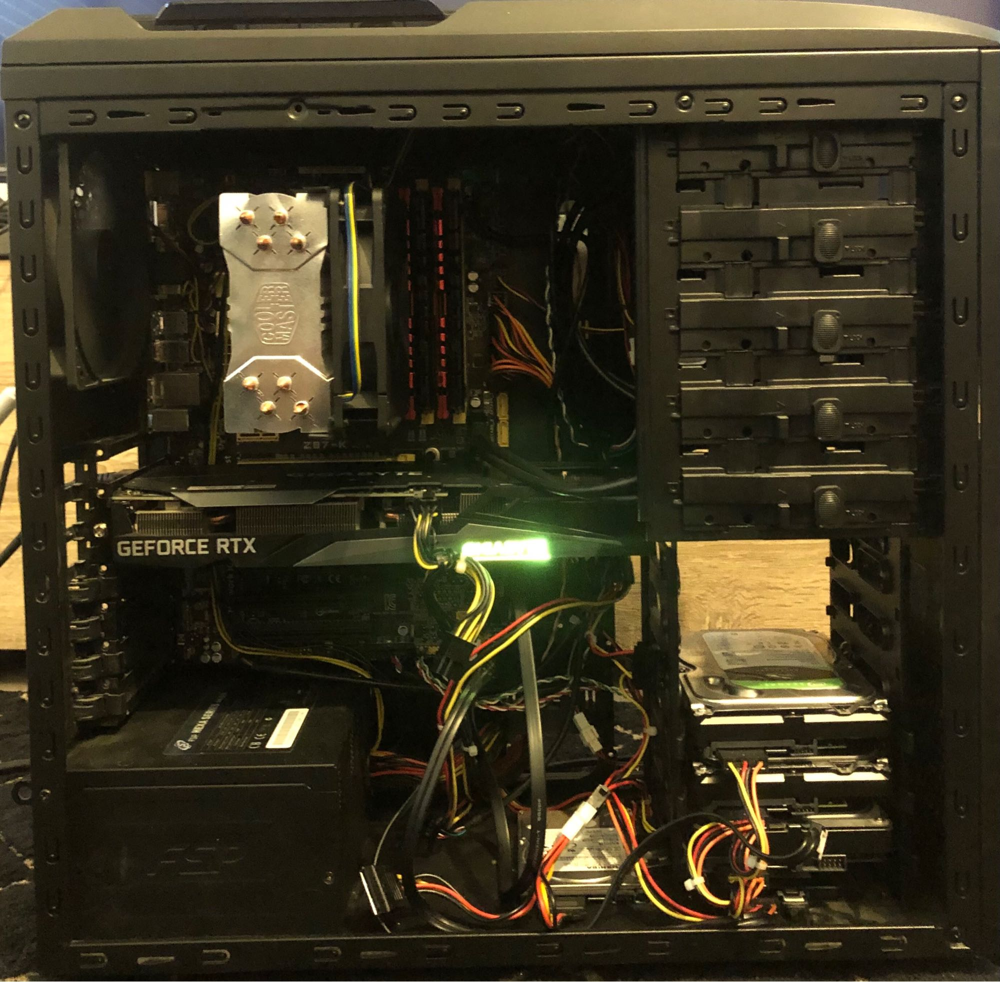
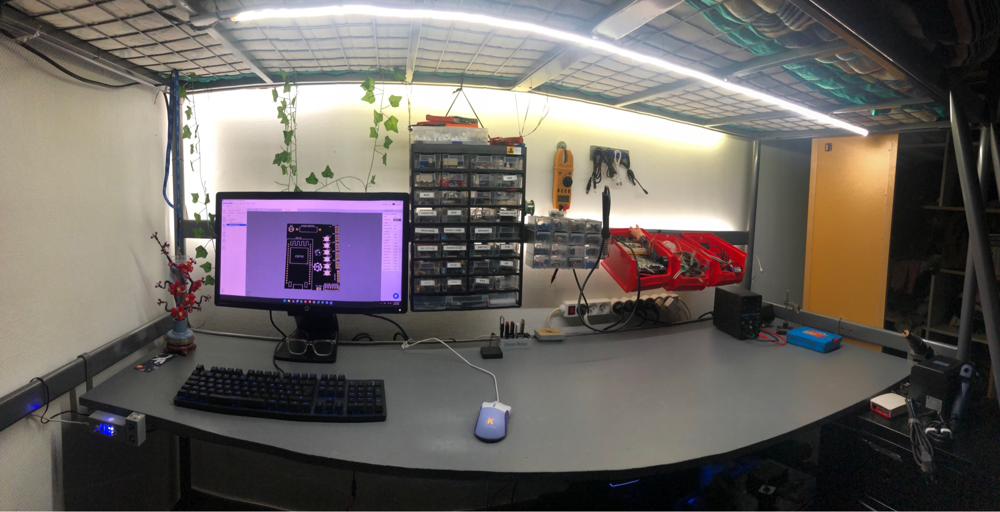
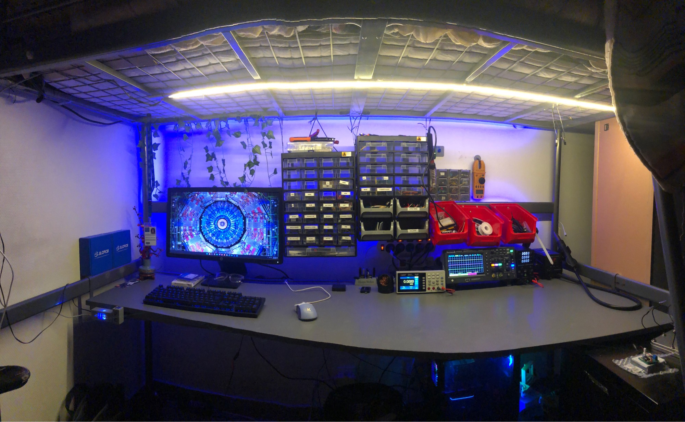

# 🔬 The Lab

> Where everything I build gets designed, soldered, measured and broken. A home electronics lab built up piece by piece since I started — and still growing.

---

## 🧰 Test & measurement

| Instrument | Model | What I use it for |
|---|---|---|
| **Oscilloscope** | Rigol MHO984 — 800 MHz, 4 ch + 16 digital, 12-bit, 4 GSa/s, 100 Mpts | My main instrument: mixed-signal debugging on my own boards, filter characterisation (Bode plot, FFT) and long serial captures thanks to the deep memory. **[Read my review →](https://github.com/jenatton-Malik/rigol-mho984-review)** |
| **Function generator** | Rigol AFG100 (built into the MHO984) — 2 ch, 100 MHz | Bode sweeps and custom arbitrary waveforms for testing filters |
| **Oscilloscope** | Hantek DSO2D15 — 150 MHz, 2 ch, 8-bit | My first real scope. A year of learning on it, now the reference for my 8-bit vs 12-bit comparison |
| **Bench multimeter** | OWON XDM1041 (55,000 counts) | Precise measurements without another handheld cluttering the desk |
| **Bench power supply** | RUZIZAO SPPS3010-2KD | High Power, 2CHA, SER/PAR, OVP and OCP, just perfect |
| **Bench power supply** | Jesverty 30 V / 10 A | Low ripple, precise, and it runs anything I need to test |
| **LCR meter** | FNIRSI LC1020E | High-precision component characterisation |
| **Logic analyser** | Rigol PLA2216 probe on the MHO984 — 16 ch | Analog and digital on a single timebase: decoding a bus while watching the real shape of the signal |
| **Logic analyser** | Alientek DL16 — 250 MHz, 16 ch | Serious digital debugging (I²C, UART, SPI), with hundreds of protocol decoders |

*The MHO984 was purchased through a review partnership with [Eleshop](https://eleshop.eu) — the [long-term review](https://github.com/jenatton-Malik/rigol-mho984-review) is in progress.*

*Logic analysis earned its place on my bench during the [I²C stress test on my robotic arm](https://github.com/jenatton-Malik/5dof-robotic-arm) — hunting for NACKs on a 1.3 m bus wrapped around a running stepper.*

---

## 🔥 Soldering & rework

| Tool | Model | Notes |
|---|---|---|
| **Soldering iron** | Geeboon TC22 | Hits temperature in ~2 s, dead accurate, cheap tips, hundreds of tip profiles available |
| **Hot air station** | Toolcraft ZD8908 | SMD rework and desoldering |
| **Fume extractor** | YIHUA 948 Q I | Because breathing flux fumes all evening is a bad plan |

---

## 🖨️ 3D printing

**Creality K1 SE — heavily modified**

Fitted with a custom plexiglass enclosure and a **temperature control system I designed and built myself**:

- ESP32 + LCD + NTC thermistor + MOSFET, powered by a 24 V → 5 V buck converter
- A web interface to monitor chamber temperature and set a target
- Simple hysteresis logic: above target + 1 °C the extraction fan runs at 100 %, down to target − 1 °C

**Filament dryer** — Sunlu

> 🤫 **Coming soon** — a fully homemade CoreXY printer, Voron Trident-style, designed from scratch and built from the bones of my old Geeetech A10M. Stay tuned.

---

## 🖥️ Homelab server

| | |
|---|---|
| **CPU** | Intel i7-4770 |
| **RAM** | 32 GB DDR3 |
| **GPU** | RTX 3060 12 GB |
| **Storage** | 10 TB HDD + 256 GB SSD (OS) |

Runs local LLMs and AI agents on the GPU, alongside Nextcloud, a NAS, Paperless and Pi-hole.

---

## 📈 How it grew

This didn't appear overnight. It started with a couple of red bins, one bench supply and a single monitor — everything else was added one piece at a time, usually because a project needed it.

  
  
  

<i>June 2025 · January 2026 · June 2026</i>

<i>Today</i>

